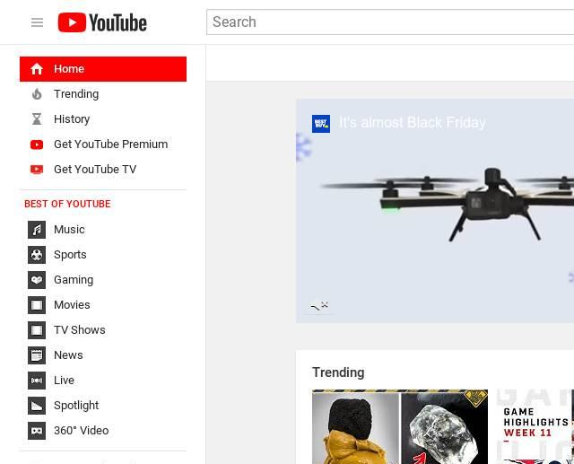
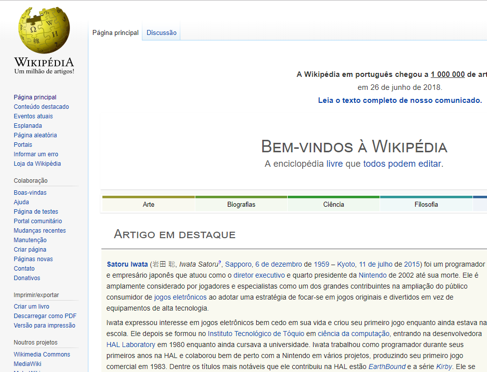
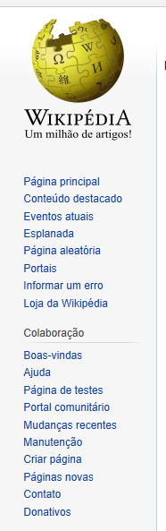
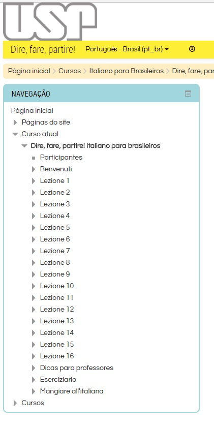

# Usability Hunter

Automated usability testing for websites — a Java RESTful API that checks common usability heuristics and returns the results as JSON.

This project was developed as a graduation thesis (*Trabalho de Graduação*) at **Faculdade de Tecnologia de São José dos Campos – ETEP**, by **Andris Araújo Andermann**, advised by **Prof. Esp. Marcelo Augusto Sudo**.

📄 Full thesis (PDF): [Usability Hunter – Teste Automatizado de Usabilidade](https://drive.google.com/file/d/13vXXaQbY6dW2SaktZVDhGMsodUhT6IJt/view?usp=sharing)

---

## What it does

Many sites are built from the developer’s own intuition instead of proven usability heuristics. That often leads to confusing navigation and a poor user experience.

**Usability Hunter** helps by automating checks for five heuristics. You send a page URL via HTTP GET; the API screenshots and analyzes the page (with Google Vision, PageSpeed, and mobile-friendliness APIs) and returns a JSON report.

```
GET /uhunter/urest/runtest?url={url_to_test}
```

Example (as deployed in the thesis):

```
https://usabilityhunter.appspot.com/uhunter/urest/runtest?url=https://www.wikipedia.org
```

---

## Heuristics tested

### 1. Logo in the top-left corner

Users often look first at the top-left to confirm they are on the right site. The logo also acts as a “home” affordance. Usability Hunter crops that region from a page screenshot and uses Google Vision (logo/text detection) to verify whether a brand/logo matching the page title is present.

<p align="center">
  
</p>

<p align="center"><em>Example: YouTube places the brand logo in the top-left — the region Usability Hunter inspects.</em></p>

### 2. Navigation on the left

Research (e.g. Bailey, 2006) suggests left-side navigation helps users find content faster. The API analyzes the left portion of the screenshot (Vision + HTML links) to decide whether primary navigation sits on the left.

<p align="center">
  
</p>

<p align="center"><em>Example: Wikipedia’s left sidebar — a classic left-navigation layout used in the thesis tests.</em></p>

<p align="center">
  
</p>

<p align="center"><em>Cropped left-nav region (sample from <code>imgTest/</code>), similar to what the navigation check focuses on.</em></p>

### 3. Hick’s law

Hick’s law: more unordered choices make selection slower. When left navigation has enough items (≥ 5), Usability Hunter checks whether those items are organized in a familiar way (e.g. alphabetical order). If there are too few items, the result is `not applicable`.

<p align="center">
  
</p>

<p align="center"><em>Example: a long left menu (USP course page). With many items, order and familiarity matter — that is what the Hick’s law check evaluates.</em></p>

### 4. Responsiveness (mobile-friendly)

Checks whether the page adapts to smaller screens using Google’s mobile-friendly test. If it fails, the JSON includes issues such as missing viewport, fixed-width layout, tiny fonts, or tap targets that are too close.

### 5. Performance

Runs Google PageSpeed-style metrics for **desktop** and **mobile**, including:

- **optimizationPoints** — how much improvement is needed (0–100; higher means more work)
- **loadingOverall** — `FAST`, `AVERAGE`, or `LOW`
- **FCP** (First Contentful Paint) and **DCL** (DOM Content Loaded), with load distribution and page speed in milliseconds

---

## JSON response (overview)

A successful run returns four top-level sections (names as in the API):

| Key | Meaning |
| --- | --- |
| `logoOnTopLeft` | `result` (boolean) and optional `logoName` |
| `navigationOnLeftCornerTest` | `navigationOnLeftCorner` + `hicksLaw` (`true` / `false` / `"not applicable"`) |
| `isMobileFriendlyTest` | `isMobileFriendly` and optional `listOfIssues` |
| `performanceTest` | Nested `mobileTest` and `desktopTest` metrics |

The thesis walks through a full Wikipedia example in **Figura 7** of the PDF.

---

## Tech stack

| Area | Technologies |
| --- | --- |
| Language / API | Java 8, Jersey (JAX-RS), Gson / JSON |
| Packaging | Maven WAR, Google App Engine |
| Page capture | Selenium |
| Vision / OCR | Google Cloud Vision |
| HTML parsing | Jsoup |
| Performance / mobile | Google PageSpeed / Search Console mobile-friendly APIs |
| Image processing | ImageJ |

Main orchestration lives in `UsabilityIntegration`; the REST entry point is `RestInterfaceImpl` (`/urest/runtest`).

---

## Sample images in this repo

The `imgTest/` folder holds screenshots used while developing and validating the heuristics (Wikipedia, Google, YouTube, Stack Overflow, USP, and cropped navigation/logo regions). They are useful reference fixtures for understanding what the tool looks at.

---

## Academic context

> *“Este artigo descreve uma API RESTful, chamada de Usability Hunter, que testa cinco dessas heurísticas: logotipo e navegação à esquerda, lei de Hick, responsividade e performance.”*

Usability Hunter was built as a prototype to plug into a website development workflow: developers can call the API and get an automated first pass on heuristics that are often skipped when teams lack time or usability specialists.

---

## License / authorship

Thesis and project by **Andris Araújo Andermann**. See the [thesis PDF](https://drive.google.com/file/d/13vXXaQbY6dW2SaktZVDhGMsodUhT6IJt/view?usp=sharing) for full references and copyright notes.
